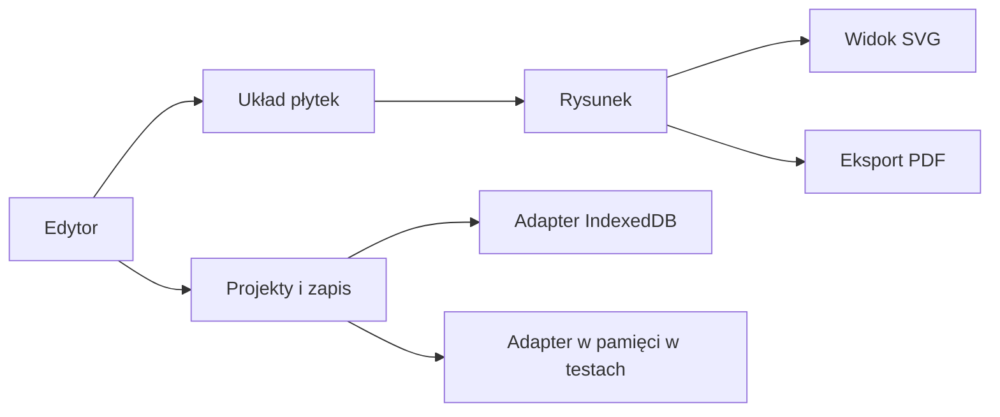

# kafelkorz — technologia i architektura MVP

Architektura realizuje [plan MVP](plans/2026-11-22-1048-feat-kafelkorz-mvp-plan.md) i używa pojęć ze [słownika](../GLOSSARY.md). Jedna aplikacja webowa i jedno repozytorium. Geometria, projekty z teksturami oraz PDF działają w przeglądarce. Serwer udostępnia pliki zbudowanej aplikacji.

## Stos technologiczny

| Obszar | Wybór | Uzasadnienie |
| --- | --- | --- |
| Aplikacja | TypeScript w trybie strict, React, Vite, CSS, npm, Node.js 24 LTS | React obsługuje stan edytora i formularze, a Vite buduje statyczny pakiet. Stan projektu i gestów może zacząć od `useReducer`. [Vite](https://vite.dev/guide/) · [Wersje Node.js](https://nodejs.org/en/about/previous-releases) |
| Rysunek | SVG w HTML, Pointer Events | SVG daje osobne kształty do zaznaczania, skalowanie widoku i warstwy opisu. Wspólny mechanizm zdarzeń pozwala obsłużyć mysz i dotyk. [SVG](https://www.w3.org/TR/SVG2/) · [Pointer Events](https://www.w3.org/TR/pointerevents3/) |
| Geometria | `@flatten-js/core`, prywatnie w module układu | Biblioteka odejmuje kształty prostokątne i okrągłe, zachowując łuki. Typy biblioteki pozostają w implementacji modułu. [FlattenJS](https://github.com/alexbol99/flatten-js) |
| Zapis | IndexedDB przez `idb` | Projekty i pliki tekstur można zapisać w jednej transakcji. `idb` pozwala używać obietnic bez zmiany modelu IndexedDB. [idb](https://github.com/jakearchibald/idb) |
| PDF | jsPDF, ładowany przy eksporcie, z dołączonym licencjonowanym fontem TTF | Generuje plik A4 w przeglądarce i obsługuje osadzenie fontu oraz ścieżki z otworami. [jsPDF](https://github.com/parallax/jsPDF) · [Dokumentacja ścieżek i maskowania](https://parallax.github.io/jsPDF/docs/jsPDF.html) |
| Testy | Vitest i Playwright z Chromium i WebKit | Vitest sprawdza czyste funkcje i kontrakt zapisu. Playwright sprawdza edytor, prawdziwy IndexedDB i pobranie pliku. Odbiór dotyku i pliku obejmuje też fizyczne telefony. [Vitest](https://vitest.dev/guide/) · [Playwright](https://playwright.dev/docs/browsers) |
| Publikacja | Statyczny `dist/`. Rekomendowany Cloudflare Pages z integracją GitHuba | Host może budować aplikację z repozytorium i obsłużyć domenę. Pakiet statyczny można przenieść na inny hosting. [Vite](https://vite.dev/guide/static-deploy) · [Integracja Cloudflare z GitHubem](https://developers.cloudflare.com/pages/configuration/git-integration/github-integration/) |

Przed publicznym testem z prawdziwymi projektami wybieramy docelowy adres. Zapis przeglądarkowy jest powiązany z adresem strony, w tym protokołem, hostem i portem. Projekty zapisane w podglądzie wdrożenia nie pojawią się automatycznie na innej domenie. [Przechowywanie danych w przeglądarce](https://developer.mozilla.org/en-US/docs/Web/API/Storage_API/Storage_quotas_and_eviction_criteria)

## Moduły i kierunek zależności

Strzałki pokazują przepływ podczas działania aplikacji. Moduł uruchomienia wybiera adapter i przekazuje go modułowi projektów. Ścieżki poniżej są proponowane, a nazwy funkcji ilustrują zakres interfejsu.

### Układ płytek

**Interfejs** w `src/layout` przyjmuje kompletną powierzchnię z jej płytką, siatką, otworami i zatwierdzonymi podziałami. Operacja `calculateLayout(surface)` zwraca obrysy kawałków, dane pomiarowe, dostępne podziały L i wskazania podziałów, które utraciły ważność. Jest deterministyczna i działa bez Reacta, DOM i dostępu do zapisu.

Implementacja oblicza współrzędne w mm, ogranicza siatkę do powierzchni z uwzględnieniem szczeliny obwodowej i odejmuje nakładające się otwory. Uwzględnia kawałki rozdzielone przez jedno wycięcie. Styczność bez ubytku powierzchni nie tworzy docinki. Okrąg pozostaje łukiem w obrysie, a wymiary i średnica pochodzą z geometrii w mm. Zaokrąglenie etykiet odbywa się przy prezentacji.

Zatwierdzony podział zapisuje zamiar użytkownika, czyli położenie i obrys wyjściowej docinki oraz kierunek podziału. Moduł układu ponownie wylicza oba prostokąty przy każdej edycji geometrii. Jeśli obrys się zmienił albo podział utracił ważność, moduł zgłasza to w wyniku. Edytor stosuje zmianę dopiero po zakończeniu gestu i wtedy oferuje cofnięcie przywracające geometrię razem z podziałem. Przy zapisie wystarczą parametry projektu i podziały. Wynikowe obrysy i wymiary są wyliczane ponownie przy otwarciu.

**Dlaczego tu jest głębokość.** Edytor, rysunek i PDF nie muszą znać reguł przecinania figur ani rozpoznawania docinek. Test wywołuje `calculateLayout` z tą samą powierzchnią co edytor i sprawdza wynik bez sięgania do FlattenJS.

### Rysunek i eksport

**Interfejs rysunku** w `src/drawing` bierze powierzchnię, wynik układu i opcje widoku. Zwraca wspólne obrysy, punkty odniesienia, oznaczenia i treść wymiarów. Widok SVG i moduł eksportu różnią się położeniem tekstu i dopasowaniem do ekranu lub strony A4. Oba korzystają z tych samych wymiarów i ID elementów. Teksturę przycina się do obrysu kawałka, razem z otworami.

**Interfejs eksportu** w `src/pdf` przyjmuje migawkę projektu z odpowiednimi rysunkami, teksturami i opcją ich wyłączenia. Zwraca gotowy plik PDF jako `Blob`. Implementacja układa strony A4, przenosi opisy zatłoczonych docinek do wykazu i osadza font. Przycisk w edytorze obsługuje pobranie. W ten sposób eksport może się zakończyć w tle bez ryzyka, że późniejsza edycja zmieni połowę drukowanego projektu.

### Projekty i zapis

Interfejs zapisu w `src/projects` obejmuje listę projektów, odczyt po ID, zapis i usunięcie. Lista czyta metadane bez ładowania zdjęć. Zapis zmienionego projektu i dołączonych plików następuje w jednej transakcji. Tekstury są plikami identyfikowanymi osobno, a zapis projektu zawiera ich ID i numer wersji formatu. Ustawienie ostatnio otwartego projektu należy do aplikacji, podobnie jak tworzenie edytowalnej kopii przykładu. [ADR 0001](adr/0001-oddzielenie-zapisu-projektu.md)

**Seam zapisu** ma dwa adaptery używane od początku. Adapter IndexedDB obsługuje realne projekty, a adapter w pamięci pozwala sprawdzić zachowanie przy przełączaniu, błędach zapisu i ponownym otwarciu przez ten sam interfejs. Przyszły adapter serwerowy może korzystać z tych samych ID i wersjonowanych danych asynchronicznie. Synchronizacja, konta i rozwiązywanie konfliktów między urządzeniami to późniejsza funkcjonalność.

Edytor kolejkuje automatyczne zapisy po ID i zapisuje zatwierdzone zmiany. Po wyczerpaniu miejsca zgłasza nieudany zapis, zachowuje bieżącą edycję w pamięci i pozwala ponowić próbę zapisu. Przed przełączeniem projektu domyka oczekujący zapis, a w razie błędu pokazuje użytkownikowi stan edycji. Usunięcie projektu unieważnia jego oczekujące zapisy. Przy edycji tego samego projektu w dwóch kartach adapter porównuje wersję zapisu w transakcji i zgłasza konflikt, chroniąc nowszą wersję przed nadpisaniem. To osobna wartość od wersji formatu danych. Testy sprawdzają błąd zapisu, konflikt i stan projektu po przeładowaniu. [Limity zapisu w przeglądarce](https://developer.mozilla.org/en-US/docs/Web/API/Storage_API/Storage_quotas_and_eviction_criteria)

### Edytor i gesty

Edytor w `src/editor` przyjmuje projekt przez moduł zapisu. Trzyma osobno wymiary projektu i stan widoku. Współrzędne z ekranu przelicza na mm przed zmianą projektu. Tryb przesuwania siatki, edycja otworu i przesuwanie powiększonego widoku prowadzą do odrębnych czynności. Aktualizacje podglądu podczas przeciągania można grupować na klatkę, a zapis następuje po zatwierdzeniu zmiany. Wydajność mierzymy na przykładach z telefonu przed decyzją o uruchomieniu obliczeń w Web Workerze. [Pointer Events](https://www.w3.org/TR/pointerevents3/)

## Sprawdzenie wyborów

W krótkiej próbie Node użyłem `@flatten-js/core@1.6.15`. Odejmowanie obsłużyło koło wewnątrz płytki, przejście przez krawędź i narożnik, styczność od zewnątrz, nakładające się koło i prostokąt, podział prostokątem na dwa kawałki oraz całkowite pokrycie płytki. Próba `jspdf@4.2.1` dała dwie strony A4 i zachowała polskie znaki oraz Ø w tekście PDF. To próby konkretnych operacji. Pełne rysowanie, maskowanie tekstury i pobieranie na telefonie weryfikujemy podczas implementacji.

Obie wersje bibliotek traktujemy jako sprawdzone w tej próbie. W implementacji dobieramy aktualne wersje i zapisujemy je w lockfile. Jeśli testy geometrii wykażą problem z konkretną kombinacją łuków i przecięć, poprawka pozostaje wewnątrz modułu układu. Biblioteka oparta na wielokątach wymagałaby jawnej tolerancji przybliżenia kół, dlatego pierwszym wyborem pozostaje FlattenJS. [FlattenJS](https://github.com/alexbol99/flatten-js) · [Operacje na wielokątach w polyclip-ts](https://github.com/luizbarboza/polyclip-ts)

## Kolejność wdrażania

1. Uruchomić szkielet Vite i sprawdzić przypadek łazienki przez interfejs układu, od docinek 132 i 384 mm do trzech otworów na jednej płytce.
2. Doprowadzić jedną powierzchnię od edycji dotykowej i wpisania liczb przez podział docinki L do wektorowego PDF.
3. Dodać listę projektów, przykłady, tekstury i zapis w IndexedDB. Sprawdzić przywrócenie projektu i niezależność zapisów.
4. Zweryfikować gęsty wydruk, obsługę dotyku oraz eksport na iPhonie i Androidzie. Opublikować statyczny pakiet po wyborze domeny i podłączeniu hostingu.
